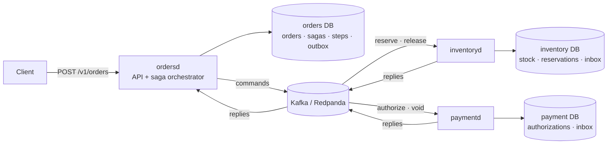
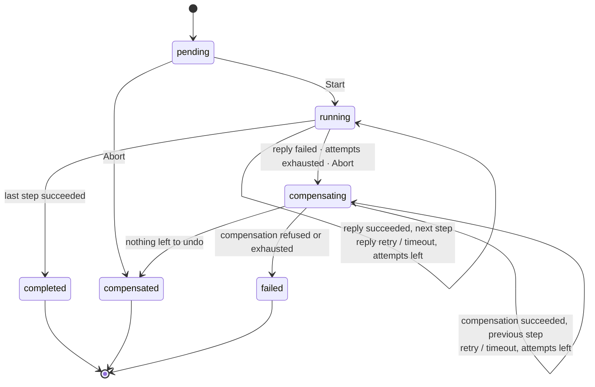

# go-saga-orders

[](https://github.com/Nguyenngoctruong274/go-saga-orders/actions/workflows/ci.yml)


[](LICENSE)

An order saga across three services in Go. Placing an order has to reserve
stock in one service and take payment in another, and either both happen or
neither does. There is no distributed transaction to lean on: each service
owns its database, they talk over Kafka, and any of them can crash
mid-flight. This project implements the saga pattern that makes the order
end up consistent anyway, with compensation when a step fails, exactly-once
effects over at-least-once delivery, and a visible timeline of what happened
to every order.

**Contents:** [Why](#why) · [Architecture](#architecture) ·
[Run it](#quick-start) · [Saga lifecycle](#saga-lifecycle) ·
[Messages and Kafka](#messages-and-kafka) ·
[Configuration](#configuration) · [Roadmap](#roadmap)

Built in public over ten days, one tested increment a day
([roadmap](#roadmap)). So far: the saga domain, a deterministic state
machine with fenced attempts, deadlines and compensation (day 2), and the
message contracts with a Kafka client that keeps per-saga order, retries
in place, dead-letters poison records and commits only what it handled,
tested against an in-memory Kafka (day 3).

## Why

Every e-commerce or ride-hailing backend has this problem and most solve it
by accident, with a `payment_status` column nobody trusts. The questions
this repository answers with code and tests:

- **Orchestration.** `ordersd` runs an explicit saga per order: reserve
  stock, authorize payment, confirm. Each step is a command on Kafka and a
  reply back; the orchestrator persists where every saga is before acting.
- **Compensation.** When payment is declined after stock was reserved, the
  reservation is released; when a step times out, the saga compensates
  what already happened. Compensations are commands too, and they retry.
- **Exactly-once effects.** Kafka delivers at least once. Every participant
  keeps an inbox of processed message ids in the same transaction as its
  effect, so a redelivered `reserve` reserves nothing twice.
- **Crash safety.** State changes and outgoing messages are written in one
  transaction (an outbox), then relayed; a daemon killed between the two
  resumes without losing or duplicating a command.
- **Choreography compared.** Day 9 runs the same participants in an
  event-driven choreography and measures what the orchestrator bought.
- **Visible.** Every order has a saga timeline: steps, attempts, replies,
  compensations, with timestamps; Prometheus metrics and alerts.

## Architecture



Three daemons from one module and one image. They share nothing but
Kafka: each has its own PostgreSQL database, and every cross-service
effect is a message.

| Package | Responsibility |
|---|---|
| `cmd/ordersd` | Orders API and the saga orchestrator |
| `cmd/inventoryd` | Stock and reservations; answers `reserve` and `release` |
| `cmd/paymentd` | Payment authorizations; answers `authorize` and `void` |
| `internal/config` | Environment configuration with validation, shared by the three daemons |
| `internal/httpapi` | Probes (`/healthz`, `/readyz`), request ids; the `/v1` API from day 8 |
| `internal/service` | Shared lifecycle: tagged JSON logger, HTTP server, graceful shutdown that fails readiness first |
| `internal/saga` | Domain: saga definitions, the instance state machine with fenced attempts, deadlines, retries and compensation, and the timeline; no I/O |
| `internal/message` | Contracts: the versioned JSON envelope, typed payloads, topics and headers, UUIDv7 ids, conversion between saga commands/replies and envelopes; no Kafka dependency |
| `internal/kafka` | franz-go client: idempotent publishing, topic creation, and a group consumer that keeps order per partition, retries in place, dead-letters and commits only handled records |

Packages still to come, by roadmap day: `internal/postgres`
and `internal/outbox` (day 4), `internal/orchestrator` (day 5),
`internal/participant` (day 6), `internal/metrics` (day 9).

## Quick start

```sh
make up              # PostgreSQL (orders, inventory, payment DBs) + Redpanda
make run-orders      # :8080
make run-inventory   # :8081, in another shell
make run-payment     # :8082, in another shell

curl -s localhost:8080/healthz   # {"status":"ok"}
curl -s localhost:8080/readyz    # {"status":"ready"}
```

`make test` runs the unit tests with the race detector; `make lint` runs
golangci-lint; `make build` puts the three binaries in `bin/`. The Docker
image holds all three daemons; pick one with the entrypoint
(`docker run --entrypoint /paymentd ...`).

### Shutdown

On `SIGTERM` or `SIGINT` a daemon fails `/readyz` immediately, keeps
serving for `SAGA_SHUTDOWN_DRAIN` so the load balancer can move traffic
away, then closes the listener and gives in-flight requests up to
`SAGA_SHUTDOWN_TIMEOUT` to finish. `/healthz` stays green throughout, so
the orchestrator does not restart a pod that is deliberately stopping.

## Saga lifecycle

`internal/saga` is the heart of the project and has no I/O: every
transition takes the current time and returns the next command to send,
and the orchestrator (day 5) stores the saga and moves the messages. That
makes the whole state machine unit-testable and fuzzable.

A **definition** is an ordered list of steps. Each step names an action
command (`inventory.reserve`), an optional compensation (`inventory.release`),
a per-attempt timeout and an attempt budget. The order saga is:

| Step | Action | Compensation | Notes |
|---|---|---|---|
| `reserve` | `inventory.reserve` | `inventory.release` | |
| `pay` | `payment.authorize` | `payment.void` | |
| `confirm` | `order.confirm` | none | the pivot: local, cannot be undone, so it goes last |



The rules the tests and the fuzzer pin down:

- **One thing in flight.** A running saga has exactly one step running; a
  compensating saga exactly one compensation. Everything after it is
  pending (forward) or already undone (backward).
- **Fenced attempts.** Every command carries the step's attempt number,
  which increases on every send, action or compensation. A reply must
  quote the saga, the step and the live attempt; anything else is
  `ErrStaleReply` and changes nothing. A late reply to a timed-out attempt
  cannot resurrect a step.
- **Three outcomes.** `succeeded` advances. `failed` is the participant's
  final answer (out of stock, card declined): it did nothing, so the step
  is not compensated, and the saga turns around. `retry` means it did
  nothing *this time*: the command is re-sent until the budget is spent,
  then treated as failed.
- **Timeouts are not failures.** A lost reply is retried like `retry`.
  When the budget is spent, the step's outcome is *unknown*: it may have
  taken effect, so it is compensated along with the steps before it.
  Participants' compensations must therefore tolerate undoing something
  that never happened (day 6).
- **Compensations get their own budget** and the same timeout. One that is
  refused, or keeps timing out, moves the saga to `failed`: nothing more
  happens automatically, an operator inspects and replays it (day 7).
- **Pivots.** A step without a compensation stands if a later step fails;
  definitions put such steps last.
- **Abort** of a pending saga compensates it on the spot; of a running one
  marks the step in flight aborted (outcome unknown, so undone too) and
  starts compensating. A saga already compensating or finished is left
  alone.
- **Version and timeline.** Each accepted transition bumps `Version`, for
  optimistic locking when the saga is stored, and appends an event
  (`step_sent`, `step_failed`, `compensation_sent`, `compensated`, ...)
  that becomes the order's timeline in the API.

`FuzzSagaInvariants` feeds a four-step definition random replies, timeouts
and aborts, including stale attempts, wrong steps, other sagas and unknown
outcomes, and checks all of the above after every operation; CI runs it
for 20 seconds on each push.

## Messages and Kafka

### The envelope

Every message, command or reply, is one JSON envelope:

```json
{
  "version": 1,
  "id": "01a1c9d5-e280-7a3c-9d2e-5b8f0c1d2e3f",
  "kind": "command",
  "type": "inventory.reserve",
  "source": "ordersd",
  "saga_id": "saga-1", "step": "reserve", "attempt": 1, "subject": "order-42",
  "correlation_id": "saga-1",
  "occurred_at": "2026-11-11T09:00:00Z",
  "deadline": "2026-11-11T09:00:10Z",
  "payload": {"order_id": "order-42", "items": [{"sku": "TEA-1", "quantity": 2}]}
}
```

- **Fencing travels with the message.** `saga_id`, `step` and `attempt`
  are what the saga needs to accept or ignore a reply; a reply copies
  them from its command, so a reply to an attempt that already timed out
  is recognised as stale after crossing Kafka twice (the round-trip test
  applies the same reply twice and gets `ErrStaleReply` the second time).
- **Correlation and causation.** `correlation_id` is the saga id on every
  message of the saga; `causation_id` is the id of the message that
  caused this one (a reply names its command; a command names the reply
  that advanced the saga). The whole conversation can be rebuilt from
  logs alone.
- **Ids are UUIDv7**: time-ordered, so the inbox tables of day 5 append
  at the end of their index, and monotonic within a process even when
  the clock steps back.
- **Versioning.** Readers ignore fields they do not know, in the envelope
  and in payloads, so a producer can add an optional field first and
  consumers learn it later. Anything else (renaming, removing, changing a
  meaning) bumps `version`; a reader refuses a version newer than its own
  with `ErrUnsupportedVersion` instead of half understanding it. An
  outcome a reader does not know is refused too: guessing would advance
  or compensate a saga wrongly.
- **Payloads are typed** (`ReservePayload`, `AuthorizePayload`, ...) and
  validated on both ends; money is `amount_minor` (an integer in the
  currency's minor unit) plus an ISO 4217 code, never a float.
- **Bounded.** An envelope over 256 KiB is refused before it reaches the
  broker. `FuzzUnmarshal` checks that nothing panics, every error is
  classified, and whatever is accepted re-encodes to the same envelope.

### Topics, keys and headers

| Topic | Written by | Read by | Holds |
|---|---|---|---|
| `inventory.commands` | ordersd | inventoryd | `inventory.reserve`, `inventory.release` |
| `payment.commands` | ordersd | paymentd | `payment.authorize`, `payment.void` |
| `saga.replies` | inventoryd, paymentd | ordersd | `*.reply` |
| `<topic>.dlq` | the consumer of `<topic>` | an operator | records that could never be handled |

Every record is keyed by **saga id**, so all the messages of one saga go
to one partition and are read in the order they were written: a
`release` can never overtake the `reserve` it undoes. Six partitions per
topic, fixed up front, because changing the count later moves keys
between partitions. `ordersd` creates the topics at start (retrying until
the broker answers); every daemon's `/readyz` fails while its broker is
unreachable.

Headers mirror the envelope (`message-id`, `message-type`,
`message-version`, `saga-id`, `correlation-id`, `causation-id`,
`content-type`) so tools can route and trace without parsing bodies. The
body stays the source of truth: a record whose headers or key disagree
with its body is rejected.

### The client

`internal/kafka` wraps [franz-go](https://github.com/twmb/franz-go).

- **Publishing** is idempotent with acknowledgement from every in-sync
  replica: a retried send is not written twice, and an acknowledged
  record survives a broker loss.
- **Consuming** is at-least-once, in a consumer group. Partitions are
  handled in parallel, the records of one partition one at a time, in
  order. Offsets are committed after the records they cover were handled,
  and rebalances wait until the batch is done, so a partition never moves
  to another process with handled records uncommitted or unhandled ones
  committed.
- **Errors.** A handler error is transient by default: the same record is
  handed over again with a doubling backoff, holding back its partition
  (and only it) rather than letting later messages of the same saga
  overtake it. An error wrapped with `kafka.Permanent` (a record that
  does not decode, a command nobody knows) sends the record to
  `<topic>.dlq` with the error and its original topic, partition and
  offset, and the partition moves on.
- **Stopping** commits what was handled and leaves the group, so the
  partitions move at once; a record in progress is handed to whoever
  resumes, which is why handlers must be idempotent (the inbox of day 5).

The tests run against `kfake`, franz-go's in-memory Kafka, which speaks
the real wire protocol over TCP: order per saga for 8 sagas spread over 6
partitions; headers and keys through the broker; a record failing three
times and then succeeding, with the records behind it waiting; a poison
record dead-lettered with its provenance while the next one is handled;
a restarted member resuming after its commits while another group reads
everything; a member stopped mid-record handing that record, and only
that one, to its successor. Making the consumer commit everything it
polled, or skip failed records, makes two of them fail.

## Configuration

All three daemons read the same variables; each deployment sets its own
database. Boolean-free and fail-fast: a misconfigured daemon lists every
invalid variable at once and exits.

| Variable | Default | Description |
|---|---|---|
| `SAGA_HTTP_ADDR` | `:8080` ordersd, `:8081` inventoryd, `:8082` paymentd | HTTP listen address |
| `SAGA_DATABASE_URL` | required | `postgres://` URL of this daemon's own database |
| `SAGA_DB_MAX_CONNS` | `20` | Maximum open database connections |
| `SAGA_KAFKA_BROKERS` | required | Comma-separated bootstrap brokers, `host:port` |
| `SAGA_KAFKA_REPLICATION` | `1` | Replication factor of the topics `ordersd` creates (1 to 7; 3 in production) |
| `SAGA_LOG_LEVEL` | `info` | `debug`, `info`, `warn` or `error` |
| `SAGA_SHUTDOWN_TIMEOUT` | `15s` | Time for in-flight requests to finish after the listener closes |
| `SAGA_SHUTDOWN_DRAIN` | `0s` | Time to keep serving with `/readyz` failing before the listener closes |

## Roadmap

- [x] **Day 1**: Scaffold: three daemons, config, probes, slog, graceful shutdown, Docker, compose with PostgreSQL and Redpanda, CI
- [x] **Day 2**: Saga domain: steps with action and compensation, state machine with fenced transitions, deadlines; fuzzing
- [x] **Day 3**: Message contracts: versioned JSON envelopes with saga, correlation and causation ids; topics and headers; Kafka client over franz-go, tested against an in-memory broker
- [ ] **Day 4**: Schema and store: orders, sagas, steps, outbox; saga creation and step transitions in one transaction; outbox relay to Kafka, ordered per saga
- [ ] **Day 5**: Orchestrator: consume replies, advance or compensate, inbox for idempotent replies, recovery of in-flight sagas after a crash
- [ ] **Day 6**: Participants: inventoryd (reserve, release) and paymentd (authorize, void) with inbox deduplication and fault injection; end-to-end happy path and compensation
- [ ] **Day 7**: Timeouts and retries: step deadlines, backoff for retriable replies, timeout triggers compensation, dead-lettered sagas, operator replay
- [ ] **Day 8**: API: `POST /v1/orders`, `GET /v1/orders/{id}` with the saga timeline, `GET /v1/sagas`, abort and replay; end-to-end tests over Kafka and PostgreSQL
- [ ] **Day 9**: Choreography mode with the same participants; orchestration vs choreography compared; metrics and alerts
- [ ] **Day 10**: Docker stack (three daemons, Redpanda, PostgreSQL, Prometheus), benchmarks, design decisions, v1.0.0

## Notes

- Go 1.25. kfake, the in-memory broker the tests use, needs it, and
  franz-go is pinned to the last releases that build with it. The build
  environment of this project cannot reach `golang.org/x`, so `kadm`
  (which imports `golang.org/x/crypto`) is not used: topics are created
  with a raw `CreateTopics` request through `kmsg`.

## License

MIT, see [LICENSE](LICENSE).
